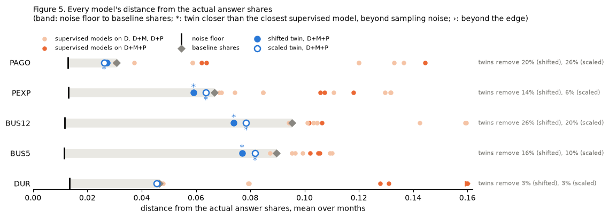

# State-dependent twins

A twin is a language model given a respondent's attributes and asked how that respondent answers. **This project asks
under what conditions LLM digital twins predict survey answers that depend on external state better than supervised
models do.** Published studies of twins mostly predict trait-like outcomes, where an answer depends mainly on who the
person is. Many of the answers that matter most for simulation in practice depend on external state instead: how people
see the economy and what they decide to buy shift with prices, jobs and the news. The project's hypothesis is that twins
predict better in a regime unlike those the models were trained on, because a language model's general knowledge of how
people respond to conditions can stand in for training data from that regime. A regime is the set of conditions under
which people answer. [`docs/motivation.md`](docs/motivation.md) explains how the question arose.

The first study, `mvp-twin`, uses the University of Michigan Surveys of Consumers, which asks households every month
about their finances and the economy. Twins and supervised models predict each respondent's answers to the five
questions behind the Index of Consumer Sentiment, called items below. Both kinds of model get the same inputs: the
respondent's attributes, with or without 10 state variables, which describe the economy and the party in power as
published before each month's interviews began. The supervised models (logit, ridge logit and gradient boosting) are
fitted to the training window, February 2017 to July 2024. The twin is Llama 3.1 8B Instruct, and two calibrated twins,
shifted and scaled, adjust its probabilities to the training window's web interviews. The evaluation window runs from
August 2024 to February 2026, and none of it can be in Llama 3.1's training data, because the model was released on the
day the window's first interviews began. The window's last 13 months begin with the first tariff orders of February 2025
and are called the tariff months below.

The study's plan was registered on [OSF](https://osf.io/ahgkw) before any twin prediction for the evaluation window
existed. Its primary test checks a prediction that follows from the hypothesis: a twin's advantage over a supervised
model given the same inputs grows as a month's regime departs from training. The prediction is about the trend of the
advantage and not its level, because a twin almost certainly handles the survey's form worse than models fitted to the
survey's answers, a handicap that the plan takes to be the same in every month. The test compares the shifted twin with
the logit, and it measures a month's departure from training by dissimilarity, the distance from the month's state
variables to those of the nearest training month.

## Results

Predictions are scored on answer shares, the shares of a month's respondents who give each answer to an item, and on
individual answers. The figure shows how far each model's predicted answer shares were from the actual shares on each
item. The further left a model is, the closer its predicted shares were. In the legend, D stands for the respondent's
attributes, M for the eight state variables for the economy and P for the two for the party in power. The grey band runs
from the noise floor, the distance that a model knowing each month's true shares would still have, to the baseline
shares.

- **Out of sample, calibrated twins predicted answer shares better than supervised models.** Beyond sampling noise, both
  calibrated twins given the state variables beat every supervised model given the same inputs on every item. They also
  beat the baseline shares, which predict the answer shares of the training window's web interviews in every month, on
  three or four items of five. The lead arose in the tariff months, the evaluation window's one regime unlike training,
  where the hypothesis expects it. One regime supports the hypothesis but cannot show that the lead recurs.
- **The preregistered test is inconclusive.** The shifted twin's advantage over the logit did not rise with
  dissimilarity: Spearman's ρ is −0.01, with a 95% interval from −0.10 to 0.10. The result says little about the
  hypothesis, because dissimilarity is at best an imperfect proxy for regime: party variables dominate it, and it omits
  the unobserved conditions that moved answers most.
- **The state variables create the lead, through each model's level.** Answer shares score only a model's level, its
  mean prediction for a month. Without the state variables, calibrated twins, supervised models and baseline shares are
  about equally close to the actual shares. With them, every supervised model moves away from the actual shares. For the
  logit this is mostly confounding: the training window holds one Republican presidency, so the logit attributes that
  presidency's optimism to the president's party and predicts it again in the tariff months. The twins move closer on
  three or four items, which puts them ahead of every supervised model, with or without the state variables, and ahead
  of the baseline shares.
- **On individual answers the twins do not lead.** Individual answers also score differences, each respondent's
  departure from the level. In differences, the logit and the ridge logit regain what the state variables cost them in
  level. Beyond sampling noise, against the supervised models given the same inputs, the scaled twin wins 8 of 15
  comparisons (five items against three supervised models) and loses 5, whereas the shifted twin loses 11.

Three limits bear on every finding: the 95% intervals count only which respondents were interviewed, the evaluation
window's 19 months hold about three episodes and only one new regime, and the study tests one model, one prompt and one
survey.

## Repository

- `notebooks/` records the work in the order it happened, and [notebook 06](notebooks/06_mvp_twin_test.ipynb) reports
  the results. A later notebook or the preregistration replaces any earlier plan it contradicts.
- `docs/prereg/` holds [the plan](docs/prereg/mvp-twin.md), frozen by the git tag `prereg/mvp-twin` and registered on
  OSF.
- `src/sdt/` holds the code: shared modules for the data, features, models and twins, and the study's own package
  `sdt.mvp`. Each module's docstring says how to run it.
- `experiments/` holds one folder per run, never changed afterwards. Its `run.json` records the commit, the SHA-256 of
  the microdata and the package versions, and `experiments/mvp/2026-11-05-twin-prereg-scores/` holds the scores reported
  above.
- `data/` gives the source, pull date and terms of every dataset.
- `AGENTS.md` gives the commit and notebook conventions, including how to rerun a notebook. A commit that changes a
  reported number is marked `!`, so `git log --oneline | grep '!:'` lists every correction.

## Reproducing

1. **Download `data.csv`** into `data/` as `data/README.md` describes, and check its SHA-256 against the one there.
2. **Install the package** with `uv venv --python 3.14 .venv` and `uv pip install -e '.[dev,twin]'`, then build the
   clean table with `.venv/bin/python -m sdt.data.clean`.
3. **Run the models:** `.venv/bin/python -m sdt.mvp.supervised <description>` fits the supervised models, and
   `.venv/bin/python -m sdt.twin.run mvp <description> --months 202404-202407,202408-202602` runs the twins. The twin
   run needs access to Llama 3.1 on Hugging Face and took about 11 GPU-hours, and `scripts/gpu_setup.sh` prepares a
   GPU machine for it.
4. **Score both runs** from Python with
   `sdt.mvp.twin_score.run('<description>', twins='<folder>', supervised='<folder>')`, naming the two folders that
   step 3 wrote in `experiments/mvp/`.

## Licence and attribution

The code is MIT-licensed. The survey data is not included: the Surveys of Consumers license the microdata for research
under CC BY-NC-ND, without the right to redistribute, and the twin prompts quote the questionnaire under its licence.
Required attribution: Surveys of Consumers, Survey Research Center, University of Michigan. Copyright © 1946–2026 The
Regents of the University of Michigan.
